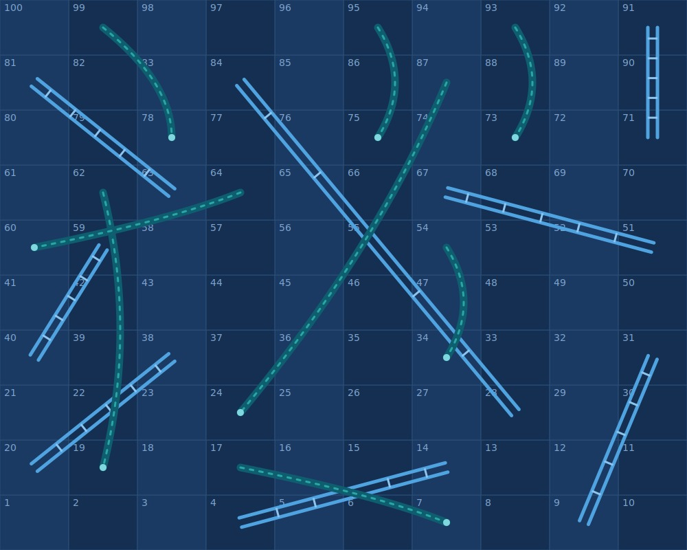

# Snake and Ladders (SFML 3, C++)

A two-player Snake and Ladders game written in C++ with SFML 3.

## Requirements
- SFML 3
- MinGW-w64 (g++)

## Build
g++ -std=c++17 gamesfml.cpp -I C:/SFML/include -L C:/SFML/lib -lsfml-graphics -lsfml-window -lsfml-system -o gamesfml.exe

Copy the SFML `.dll` files next to `gamesfml.exe` before running.

## Controls
- Type names, Tab to switch, Enter to start
- Space to roll
- R to restart after a win